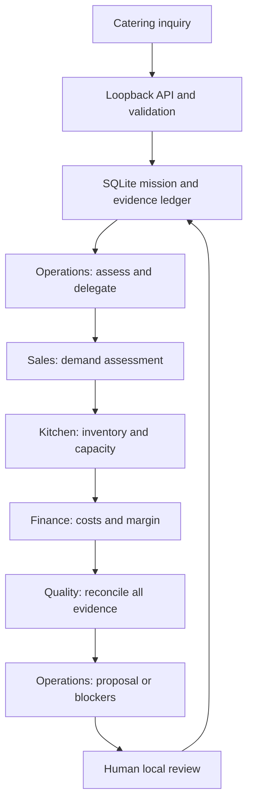

# AIZOYA restaurant operations — development architecture

Status: isolated candidate. Governing standard: approved OS 2.6. No production,
submission or release authority. Research date: October 18, 2026.

## System boundary

The independently runnable product has a responsive browser client, loopback HTTP
API, SQLite mission ledger and constrained Node subprocess workers. There are five
specialist identities. The demonstrated path uses deterministic workers, not live
LLM reasoning. A separate eve root Operations agent and four declared specialists
compile successfully but have not made live calls or been wired into the UI engine.
This separation is explicit in the interface and evidence packets.

## Authoritative records and contracts

`src/contracts.ts` defines strict Zod input/output contracts and TypeScript types.
Unknown fields are rejected, including customer email or hidden actions. Inquiry
contains guest count, menu, service time, pre-tax budget, declared allergen codes
and a labeled representative scenario. No free text, customer identities or uploads.

Each mission stores an immutable request and synthetic catalog snapshot. Input,
snapshot, task output and proposal hashes are linked into the mission's audit
events. All task inputs carry the same UUID missionId. Each task is bound to the
mission and role through a composite key; outputs cannot be attached by caller
choice. Role results are schema validated before advancing the ledger.

Operations assesses lead time and records delegation to the four other roles.
Sales normalizes structured demand. Kitchen checks a 5% inventory buffer,
capacity, freshness and allergen conflicts. Finance uses integer cents. Quality
recomputes all prior role outputs from the supplied authoritative snapshot;
it blocks inconsistencies, shortage, capacity, stale data, allergen uncertainty,
short lead time, budget shortfall and margin violations. No food-safety certification.

## Durable state and concurrency

Mission states: QUEUED → RUNNING → APPROVAL_READY or BLOCKED. A proposal can then
be marked REVIEWED_LOCAL. All states keep `executionAuthorized=false`.

Tasks move PENDING → RUNNING → DONE, retryable PENDING, or FAILED. SQLite WAL,
foreign keys, unique `(tenant,idempotency_key)` and `(mission_id,role)`, and
`BEGIN IMMEDIATE` protect claims and writes. Task claims receive a unique lease
token and expiry. Output updates compare the exact lease token, fencing stale
workers. Completed tasks are never repeated on restart. Expired leases recover.

The server scans queued/running missions every 250ms. Tool runtime is 2 seconds
per subprocess by default; it is killed on timeout. Transient inventory errors,
timeouts and worker-start failures get at most 3 persisted attempts, with 200ms
then 400ms backoff. Contract/data failures block immediately. Failure events
record code, attempt and measured duration without raw exception contents.

Corrected data uses `POST /api/missions/:id/revise` with a fresh idempotency key.
A new mission is linked to the old one; failed source records remain intact.
There is no in-place rewrite of the reviewed proposal. Concurrent real booking
reservations are outside the current scope: every mission evaluates its own
representative snapshot, so this cannot yet prevent real-world double booking.

## Tool and permission boundary

Local workers are trusted authored code, not arbitrary generated code. Their
environment excludes provider credentials. Node permission mode allows reads
only from src, node_modules and package.json. Filesystem writes and subprocess
creation are denied. No outbound tools are exposed by worker code. Node 24's
permission model does NOT enforce network egress restrictions; network isolation
needs an OS/container boundary before untrusted or live generated work. Node
permission mode is defense in depth, not a hardened hostile-code container.

The eve agents have optional default tools disabled and one authored read-only
tool per role. Operations has the four specialist delegation tools; root-copy
delegation is disabled. No connection definitions or external side-effect tools.
Model limits are configured, but framework-reported cost caps are not prepaid
spend guarantees and have not been runtime validated.

## Approval and evidence

Local review requires literal `true`, the exact proposal digest, passing quality,
valid evidence hashes, fresh catalog evidence and remaining lead time. It records
the fixed local development operator and expires with evidence. A local review
does not map to AIZOYA organizational authority or authorize execution. No send,
reserve, pay, publish, deploy or submit endpoint is implemented.

Audit events are hash chained per mission. Evidence links are session-protected
API reads and packets can be downloaded. This detects changed records against the
stored chain; it is not an externally anchored, signed or tamper-proof audit log.
A database administrator could rewrite both records and hashes. Production needs
external anchors, retention policy and authorization review.

## Measured versus planned

Measured: unit/integration behavior, real local worker execution, browser-to-API-
SQLite-to-result journey, reload persistence, mobile width, retry and timeout.
Planned: dashboard-to-eve live execution, approved LLM provider, one justified sponsor
integration, production auth/database, booking reservations and real pilot data.
No managed infrastructure, tenant database or environment was provisioned.
